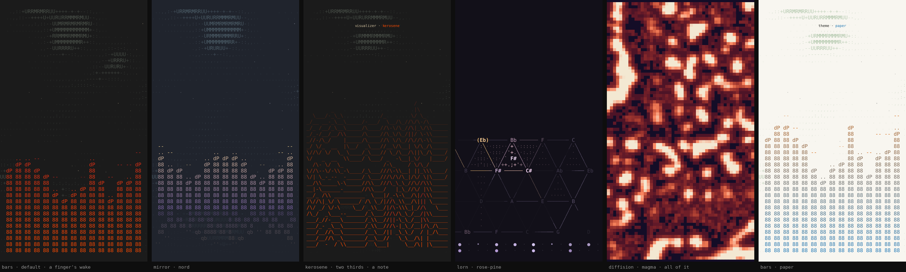

# Cornholio NCS — live wallpaper

cornholio's NCS visualizer as an Android live wallpaper, listening to whatever
the phone plays. All five looks are here (bars, mirror, kerosene, lorn and
diffision), with the flow of letters behind them and the dust. It's a Java port
of cornholio's `AudioTap` and `NCS` scene (`cornholio.py` is included), checked
frame for frame against the script: every cell has the same glyph, ink, ground
and boldness, and the levels, beats and hits match, for every look, in
several themes. There's no clock. No libraries; the APK is about 1 MB.

Colours follow the focus / cornholio Design System, as in cornholio itself.
It has the sixteen themes, one at a time, and a theme change cross-fades
everything at once in 0.9 s. Notes are short, lowercase and fade on their own.
The wallpaper also gives Android its theme's colours, so a launcher that
follows them can turn its labels dark on paper and catppuccin-latte.

## How it hears

It uses Android's Visualizer on the output mix, the system's own tap for music
visualizers, and reads it a hundred times a second. Its overlapping snapshots
are stitched back into one stream and fed to cornholio's AudioTap at 16 kHz,
the way parec feeds it on Linux. From there it's cornholio's own analysis: 32
bands, gate, ceiling, beats and hits, and the chromagram that drives lorn.

Android files this under the microphone permission and asks whether it may
"record audio". The microphone is never opened, and nothing is recorded or
kept. If you'd rather not allow it, set **listening** to **the demo song**,
cornholio's own little song, which needs no permission.

- **loudness · as played** follows the volume; **evened out** keeps the same
  height at any volume.
- On some phones, sound sent to Bluetooth headphones goes past the mix the
  Visualizer hears. If the bars stay flat with headphones on, that's why.

## Gestures

One finger always belongs to the launcher (pages, the app drawer), so nothing
you do there changes the wallpaper.

| Gesture | Does |
|---|---|
| two fingers | paint a wake through the letters (the field's trail, as cornholio's mouse) |
| tap with two fingers | next visualizer |
| tap with three fingers | next theme |

The **trail** setting can let any finger paint instead, or turn painting off.

## Getting it on the phone

1. Create a new GitHub repository and push everything in this folder,
   including the hidden `.github` folder, to its top level.
2. GitHub builds the app on its own. Watch the **Actions** tab (3–4 minutes).
3. On the phone, open the repository's **Releases** page, download
   `CornholioNCS.apk` and open it.
4. Open **Cornholio NCS** from the app drawer, tap **permission** to allow
   listening, then **wallpaper · set it**. Choose home, or home and lock screen.

Every push to `main` builds a new release, which installs over the old one.
It lives alongside the other wallpapers (Aphex Spin, Aphex Chrome); each is a
separate app.

## Settings

The settings are one plate under a live preview, which plays the demo song;
a finger paints the letters there. Tap a row to go forward, hold it to go
back. Every change shows at once and is saved.

These are the rows:

- **wallpaper**: opens the system picker.
- **listening**: the phone's sound, or the demo song.
- **permission**: shows whether it may listen, and asks.
- **loudness**: as played, or evened out.
- **visualizer**: bars, mirror, kerosene, lorn or diffision.
- **theme**: the sixteen themes.
- **reach**: how much of the screen the visualizer takes (half, two thirds,
  all of it).
- **flow behind**: the flow of letters behind the visualizer.
- **trail**: which fingers paint.
- **song letters**: the field takes the playing song's letters.
- **size**: characters across the screen.
- **frame rate**.

**song letters** is off by default. It needs notification access, which it
uses only to read the title of the song that's playing. Android 13 and later
grey that switch out for apps installed from an APK. If that happens, open
App info, tap ⋮ and choose **Allow restricted settings**, then try again.

It draws nothing and hears nothing while it's hidden or the screen is off.
After three seconds of silence it drops to a dozen frames a second (five with
the flow off) and listens twenty times a second instead of a hundred. A touch,
or the music coming back, brings it straight back to full speed.

## Files

- `app/src/main/java/com/cornholio/ncs/`
  - `AudioTap`, `Spectrum`, `Stitch`: listening and analysis, pure Java (`Stitch`
    rebuilds one stream from the Visualizer's snapshots)
  - `Ncs`, `NcsBars`, `Mirror`, `Kerosene`, `Lorn`, `Diffision`, `GlyphField`,
    `Dust`, `Trail`, `Theme`, `Cells`, `PyRandom`: the scene, pure Java
  - `Listener`, `Runner`, `Painter`, `NcsWallpaper`, `PreviewView`,
    `SettingsActivity`, `SongListener`, `Prefs`, `Assets`: the Android side
- `app/src/main/assets/`: DejaVu Sans Mono, regular and bold
- `tools/parity/run.sh`: checks the scene against `cornholio.py`, frame for
  frame. It needs python3 (with numpy for diffision) and a JDK.
- `tools/Shots.java`: desktop pictures of the wallpaper (`docs/looks.png`)
- `keystore/cornholio.jks`: the signing key, kept here so updates install over each other
